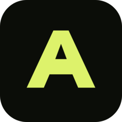
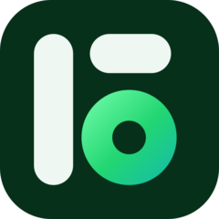
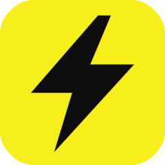
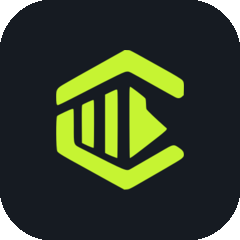
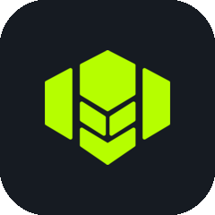
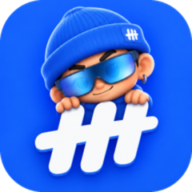

<div align="center">



<br/>

<a href="https://arpitporfolio.vercel.app/"></a>
<a href="https://www.linkedin.com/in/arpit-singh-1a857b2a9"></a>
<a href="https://x.com/_arpit1"></a>
<a href="mailto:adoranto737@gmail.com"></a>
<a href="https://codolio.com/profile/LSUDOKO"></a>
<a href="https://www.youtube.com/@LSUDOKO"></a>
<a href="https://t.me/ADORANRO"></a>
<a href="https://discord.com/users/arpit7195"></a>
<br/><br/>

<a href="https://github.com/LSUDOKO?tab=followers"></a>

</div>

---

## About

I'm a B.Tech Computer Science student at **NIT Hamirpur**, working across full-stack engineering, Web3 and systems programming.

Most of what I build sits in one lane: **giving autonomous AI agents money, guardrails and accountability.** Scoped spending cards, runtime firewalls, on-chain budgets an agent cannot exceed, and agents that earn their autonomy instead of being handed it. If an agent is going to hold a wallet, something has to sit between it and the money. That is what I build.

Alongside that I contribute to **HPX**, the C++ Standard Library for Parallelism and Concurrency, and I was an **LFX Mentee 2025** at the Linux Foundation on the Magma distributed mobile core.

```yaml
focus:      AI agent infrastructure · Web3 protocols · Distributed systems
languages:  C++ · TypeScript · Go · Python · Rust · Solidity · Move · Scala
currently:  Runtime guardrails and spend controls for autonomous agents
open_to:    SWE internships · Open-source collaboration · Hackathon teams
reach_me:   adoranto737@gmail.com
```

---

## At a Glance

<div align="center">

<table>
  <tr>
    <th align="center" width="33%">Hackathons</th>
    <th align="center" width="33%">Competitive Programming</th>
    <th align="center" width="33%">Open Source</th>
  </tr>
  <tr>
    <td align="center"><h3>9</h3><sub>wins &amp; top placements</sub></td>
    <td align="center"><h3>1,265</h3><sub>problems solved across 6 platforms</sub></td>
    <td align="center"><h3>74</h3><sub>merged pull requests</sub></td>
  </tr>
  <tr>
    <td align="center"><b>$15,600+</b> &amp; 10k FLOW in prizes and grants</td>
    <td align="center"><b>28</b> rated contests</td>
    <td align="center"><b>40</b> external repos contributed to</td>
  </tr>
  <tr>
    <td align="center"><b>20+</b> hackathons entered</td>
    <td align="center"><b>1610</b> CodeChef peak · <b>1372</b> Codeforces peak</td>
    <td align="center"><b>5,500+</b> contributions in the last year</td>
  </tr>
</table>

<sub>Competitive programming figures from <a href="https://codolio.com/profile/LSUDOKO">Codolio</a> · GitHub figures from the GitHub API · November 2026</sub>

</div>

---

## Hackathons

<div align="center">

| Result | Prize | Event | Project |
|:---|:---|:---|:---|
| 🏆 **4th Place** | **$750** | Builder.io Agent-Native Hackathon 2026 | [Apprentice](https://github.com/LSUDOKO/Apprentice) |
| 🏆 **Top 10 Fresh Code** | $5,000 | PL_Genesis: Frontiers of Collaboration | |
| 🥇 **1st Place** | $5,000 | Forte Hacks by Flow | [Flow Fantasy Fusion](https://www.hackquest.io/projects/Forte-Hacks-by-Flow-Build-with-Disney-Dune-and-Dapper-Flow-Fantasy-Fusion) |
| 🥇 **1st Place** | $3,000 | MetaMask Card Dev Cook-Off | [Cross-Chain Rewards Hub](https://github.com/LSUDOKO/cross_chain_rewards_hub) |
| 🏆 **Top 5** | 10,000 FLOW | Flow Grant DAO | [DoraHacks BUIDL](https://dorahacks.io/buidl/38822) |
| 🏆 **Top 8** | $300 + $1k grant | ONE HACK 2025 | [RWA Exchange](https://github.com/RWA-Exchange/RWA-Exchange-OneChain) |
| 🏆 **Dual Track** | $575 | MetaMask &amp; Solana | |
| 🥉 **3rd Place** | NordVPN | Hack for Hope | [Blind Navigator](https://devpost.com/software/blind-navigator) |
| 🏆 **4th Place** | AOPS + .xyz | PortXFolio | [Portfolio](https://devpost.com/software/arpit-portfolio) |
| 🏆 **Winner** | XYZ + NordVPN | HackEMinds 2025 | [Speak Pro AI](https://devpost.com/software/speak-pro-ai-wsc64u) |

<sub>9 hackathon wins &amp; top placements · Flow Grant DAO · 20+ hackathons entered</sub>

</div>

---

## Featured Work

> Most recent first. Every project is public and open source.

<table>
  <tr>
    <td width="50%" valign="top" align="center">
      
      <h3><a href="https://github.com/LSUDOKO/Apprentice">Apprentice</a></h3>
      <sub>🏆 <b>4th Place · $750</b> · Builder.io Agent-Native Hackathon 2026</sub>
      <p>An agent that learns your issue triage by watching you work. Every click becomes a typed demonstration, repeated patterns become editable playbooks, and the agent proves itself with backtests and regression tests before it earns autonomy on a trust ladder.</p>
      
      
      
      <br/>
      <a href="https://github.com/LSUDOKO/Apprentice"></a>
      <a href="https://apprentice-agent.pages.dev"></a>
      <a href="https://clips.agent-native.com/share/77mChMteEQ6M"></a>
    </td>
    <td width="50%" valign="top" align="center">
      
      <h3><a href="https://github.com/LSUDOKO/ReRoom">ReRoom</a> &amp; <a href="https://github.com/LSUDOKO/ReRoom-MR">ReRoom MR</a></h3>
      <sub>Manycore Aholo Global 3D AI Hackathon 2026</sub>
      <p>Scan it, remix it, live in it. Redesign your real room in 3D with real-size AI furniture whose doors and drawers open, walk through it in the browser or in VR, and export to GLB or USDZ. The MR edition lets you furnish your room on Meta Quest with your hands alone.</p>
      
      
      
      <br/>
      <a href="https://github.com/LSUDOKO/ReRoom"></a>
      <a href="https://reroom.adoranto737.workers.dev"></a>
      <a href="https://reroom-mr.adoranto737.workers.dev/xr"></a>
    </td>
  </tr>
  <tr>
    <td width="50%" valign="top" align="center">
      
      <h3><a href="https://github.com/LSUDOKO/Pharmakon">Pharmakon</a></h3>
      <sub>EthnoHack 2026 · Traditional Knowledge track</sub>
      <p>Two thousand years of Greek plant medicine, measured. Maps Dioscorides' 1st-century Greek to probable modern species, compounds and targets, then ranks untested research leads with explicit uncertainty. Ships as a website, an MCP server and a JSON API, with a citable DOI.</p>
      
      
      
      <br/>
      <a href="https://github.com/LSUDOKO/Pharmakon"></a>
      <a href="https://pharmakon.adoranto737.workers.dev"></a>
      <a href="https://youtu.be/d-kbvFd2K04"></a>
    </td>
    <td width="50%" valign="top" align="center">
      
      <h3><a href="https://github.com/LSUDOKO/BoardLoop">BoardLoop</a></h3>
      <sub>Hermes Agent plugin for hardware</sub>
      <p>The agent doesn't just write firmware, it proves it works. Writes ESP32 and Arduino code, compiles it with arduino-cli, runs it on a simulated circuit in Wokwi, fixes what fails, then flashes your real board only after you approve.</p>
      
      
      
      <br/>
      <a href="https://github.com/LSUDOKO/BoardLoop"></a>
      <a href="https://boardloop.pages.dev"></a>
      <a href="https://youtu.be/rmpxsMKtOE4"></a>
    </td>
  </tr>
  <tr>
    <td width="50%" valign="top" align="center">
      
      <h3><a href="https://github.com/LSUDOKO/Foreman">Foreman</a></h3>
      <sub>SERV Hackathon Edition 02 · Kite track</sub>
      <p>An outcome agent paid only for proven results. It phones a clinic's no-show patients, rebooks them in the real Cal.com calendar, and hires phone and proof-oracle agents over x402 on Kite, settling per verified rebooking.</p>
      
      
      
      <br/>
      <a href="https://github.com/LSUDOKO/Foreman"></a>
      <a href="https://foreman-agent.pages.dev"></a>
    </td>
    <td width="50%" valign="top" align="center">
      
      <h3><a href="https://github.com/LSUDOKO/Reins">Reins</a></h3>
      <sub>NEAR Hackathon 2026 · AI Security &amp; Agent Economy</sub>
      <p>Give your agent a spending limit, not your keys. The agent holds a NEAR function-call key that can only ask; the contract holds the rules. Works for NEAR, NEP-141 stablecoins and other chains through Chain Signatures. MCP-ready.</p>
      
      
      
      <br/>
      <a href="https://github.com/LSUDOKO/Reins"></a>
      <a href="https://reins.adoranto737.workers.dev"></a>
    </td>
  </tr>
  <tr>
    <td width="50%" valign="top" align="center">
      
      <h3><a href="https://github.com/LSUDOKO/CargoFlow">CargoFlow</a></h3>
      <sub>Colosseum Crypto World's Fair · Robinhood Chain track</sub>
      <p>Evidence-gated working capital for physical trade finance. USDG escrow whose tranches release only on verified shipment evidence, with ZK recovery, an advisory AI monitor and a published SDK and MCP server. 700+ tests across contracts, circuits and frontend.</p>
      
      
      
      <br/>
      <a href="https://github.com/LSUDOKO/CargoFlow"></a>
      <a href="https://cargoflow.adoranto737.workers.dev"></a>
    </td>
    <td width="50%" valign="top" align="center">
      
      <h3><a href="https://github.com/LSUDOKO/VeriCanopy">VeriCanopy</a></h3>
      <sub>IEEE ClimateChain Global Hackathon 2026</sub>
      <p>Forest carbon credits that prove themselves. Satellite AI scores each forest, zkML proofs are verified on-chain on Base Sepolia, evidence is signed with post-quantum ML-DSA-65, and an MCP server lets agents audit any credit.</p>
      
      
      
      <br/>
      <a href="https://github.com/LSUDOKO/VeriCanopy"></a>
      <a href="https://vericanopy.vercel.app"></a>
    </td>
  </tr>
  <tr>
    <td width="50%" valign="top" align="center">
      
      <h3><a href="https://github.com/LSUDOKO/Tally">Tally</a></h3>
      <sub>CLOCK IN · Solana Mobile Hackathon</sub>
      <p>Let your agent pay, only for what tallies. An AI agent may pay only for an item a merchant signed, at the signed price, to the registered merchant, inside your rules. A Solana program checks every payment and anything else reverts.</p>
      
      
      
      <br/>
      <a href="https://github.com/LSUDOKO/Tally"></a>
      <a href="https://youtu.be/Bj0FDTXTpZA"></a>
    </td>
    <td width="50%" valign="top" align="center">
      
      <h3><a href="https://github.com/LSUDOKO/FairNest">FairNest</a></h3>
      <sub>NEAR Hackathon 2026 · NFTs &amp; Real-World Money</sub>
      <p>Rent security-deposit escrow where the deposit is a NEP-171 NFT that moves with the tenant. Itemised claims with evidence, line-by-line disputes, a neutral arbiter and deadlines, so nobody can sit on the money.</p>
      
      
      
      <br/>
      <a href="https://github.com/LSUDOKO/FairNest"></a>
      <a href="https://fairnest.adoranto737.workers.dev"></a>
      <a href="https://youtu.be/cMCJI5074Dw"></a>
    </td>
  </tr>
  <tr>
    <td width="50%" valign="top" align="center">
      
      <h3><a href="https://github.com/LSUDOKO/Pehra">Pehra</a></h3>
      <sub>Heat safety for India's outdoor workers</sub>
      <p>Turns the free weather forecast into WBGT work-rest plans in Hindi, on WhatsApp, with Hindi phone calls for alerts. Sites without a smartphone get a ₹600 Site Box on AWS IoT Core with a live 3D digital twin.</p>
      
      
      
      <br/>
      <a href="https://github.com/LSUDOKO/Pehra"></a>
    </td>
    <td width="50%" valign="top" align="center">
      
      <h3><a href="https://github.com/LSUDOKO/Phone-Senses">Phone Senses</a></h3>
      <sub>Hermes Agent plugin for Android</sub>
      <p>Gives an agent the senses of your own Android phone through Termux:API: notifications, SMS, UPI money, a live scam tripwire and find-my-phone. One API call per question instead of screenshots and taps, and it asks before it sends anything.</p>
      
      
      
      <br/>
      <a href="https://github.com/LSUDOKO/Phone-Senses"></a>
      <a href="https://phone-senses.pages.dev"></a>
    </td>
  </tr>
</table>

### Agent Infrastructure & Protocols

| Project | What it does | Stack | Links |
|:---|:---|:---|:---|
| **[Vigil](https://github.com/LSUDOKO/Vigil)** | Runtime firewall for AI agents: governs every tool call, enforces token budgets, blocks unsafe actions and streams an audit trail | Go · Observability | [Live](https://vigil-featherless.vercel.app/) |
| **[GlassPay](https://github.com/LSUDOKO/GlassPay)** | Scoped, revocable spending cards for agents on ERC-7710 delegations, with gasless settlement and SigNoz tracing | TypeScript · ERC-7710 | [Live](https://glass-pay.vercel.app) |
| **[CapMatrix](https://github.com/LSUDOKO/CapMatrix)** | Multi-agent DeFi rooms where every agent runs under hard-capped, on-chain enforced budgets | TypeScript · Agentic DeFi | [Live](https://capmatrix.vercel.app) |
| **[AGORA](https://github.com/LSUDOKO/AGORA)** | Marketplace where agents discover, contract and pay each other, with settlement and reputation on X Layer | TypeScript · X Layer | [Live](https://agoraxlayer.netlify.app) |
| **[Replicant](https://github.com/LSUDOKO/replicant)** | Evolutionary agent protocol: agents compete, mutate and inherit traits across generations, recorded on 0G | TypeScript · 0G Labs | [Live](https://replicant0g.me/) |
| **[ContextCard](https://github.com/LSUDOKO/ContextCard)** | MCP server wiring DataHub lineage and Stripe so finance agents answer from real catalog metadata | TypeScript · Stripe · MCP | [Live](https://contextcard-dashboard.vercel.app/) |
| **[Wraith](https://github.com/LSUDOKO/Wraith)** | Private conditional orders on Flare: the trigger is encrypted to a TEE and never published, so MEV can't hunt it | Solidity · Go · TEE | [Live](https://wraith-jet.vercel.app) |
| **[ContextCI](https://github.com/LSUDOKO/ContextCI)** | Autonomous data SRE: catches breaking schema changes in PRs, traces column lineage and writes the dbt fixes | Python · dbt · Actions | [Docs](https://lsudoko.github.io/ContextCI) |
| **[TrackRails](https://github.com/LSUDOKO/TrackRails)** | Music stem marketplace on Story Protocol: pay to unlock individual stems, royalties split automatically | Solidity · Next.js | [Live](https://track-rails.vercel.app) |
| **[One Clash Fighters](https://github.com/LSUDOKO/One-Clash-Fighter)** | Retro on-chain fighting game on Movement: mint fighters, stake MOVE in tournaments, live leaderboard | Move · GameFi | [Live](https://one-clash-fighter.vercel.app) |

<details>
<summary><b>More projects: award winners &amp; earlier work</b></summary>

<br/>

| Project | What it does | Stack |
|---------|--------------|-------|
| [Flow Fantasy Fusion](https://www.hackquest.io/projects/Forte-Hacks-by-Flow-Build-with-Disney-Dune-and-Dapper-Flow-Fantasy-Fusion) | AI-powered fantasy sports dApp with automated settlement and multi-asset staking across three Cadence contracts. **1st Place, $5,000** | Cadence · React · Gemini |
| [Cross-Chain Rewards Hub](https://github.com/LSUDOKO/cross_chain_rewards_hub) | Unlocks value from idle NFTs across Ethereum Sepolia and Polygon Amoy: stake, earn, convert to USDC via CCTP v2. **1st Place, $3,000** | Solidity · CCTP v2 · MetaMask |
| [RWA Exchange (OneChain)](https://github.com/RWA-Exchange/RWA-Exchange-OneChain) | Marketplace for tokenized real-world assets with fractional ownership. **Top 8, ONE HACK 2025** | Move · Next.js · IPFS |
| [KeeperCard](https://github.com/LSUDOKO/KeeperCard) | Spending cards for AI agents: KeeperCard decides what an agent may spend, KeeperHub moves the money | TypeScript |
| [SuiPass](https://github.com/LSUDOKO/SuiPass) | Scoped, revocable spending cards for agents on Sui, checked against on-chain budget windows, caps, expiry and allowlists | Move · Sui · x402 |
| [VisionDoctor](https://github.com/LSUDOKO/VisionDoctor) | Agentic camera-health AI on OpenCV 5: diagnoses 11 camera faults and predicts lost detector accuracy without labels | Python · OpenCV · AWS Bedrock |
| [NaviQ](https://github.com/LSUDOKO/NaviQ) | Quantum-inspired maritime decarbonisation with hybrid QUBO/QPSO fleet optimisation. SIH 2026 | Python |
| [PrivaCRE](https://github.com/LSUDOKO/PrivaCRE) | Privacy-preserving credit scoring for under-collateralized DeFi loans via Chainlink CRE and World ID | Solidity · Chainlink |
| [GoalSwap](https://github.com/LSUDOKO/GoalSwap) | World Cup trading where predictions, fan tokens and meta-markets share one Uniswap V4 hook | Solidity · Uniswap V4 |
| [Signal](https://github.com/LSUDOKO/signal) | Slack agent that makes work chat navigable for people with ADHD and autism | Go · Slack API · MCP |
| [Clyvo](https://github.com/LSUDOKO/Clyvo) | Microservice e-commerce backend in Go | Go |
| [Blind Navigator](https://devpost.com/software/blind-navigator) | Computer-vision navigation for visually impaired users. **3rd Place, Hack for Hope** | Python · OpenCV |
| [Speak Pro AI](https://devpost.com/software/speak-pro-ai-wsc64u) | AI communication and speech coaching. **Winner, HackEMinds 2025** | Python · React |
| [Bingo](https://github.com/LSUDOKO/Bingo) | Real-time multiplayer Bingo with WebSocket rooms and live chat | Django Channels |

</details>

---

## Competitive Programming

<div align="center">

<table>
  <tr>
    <th align="left">Platform</th>
    <th align="center">Solved</th>
    <th align="center">Rating (peak)</th>
    <th align="center">Contests</th>
    <th align="center">Profile</th>
  </tr>
  <tr>
    <td> <b>LeetCode</b></td>
    <td align="center"><b>633</b><br/><sub>247 easy · 314 medium · 72 hard</sub></td>
    <td align="center">1468</td>
    <td align="center">1</td>
    <td align="center"><a href="https://leetcode.com/u/ARPIT737/">ARPIT737</a></td>
  </tr>
  <tr>
    <td> <b>Codeforces</b></td>
    <td align="center"><b>292</b></td>
    <td align="center">1372 · Pupil</td>
    <td align="center">19</td>
    <td align="center"><a href="https://codeforces.com/profile/LSUDOKO">LSUDOKO</a></td>
  </tr>
  <tr>
    <td> <b>CodeChef</b></td>
    <td align="center"><b>249</b></td>
    <td align="center">1610</td>
    <td align="center">5</td>
    <td align="center"><a href="https://www.codechef.com/users/lsudoko">lsudoko</a></td>
  </tr>
  <tr>
    <td> <b>GeeksforGeeks</b></td>
    <td align="center"><b>71</b></td>
    <td align="center">–</td>
    <td align="center">–</td>
    <td align="center"><a href="https://www.geeksforgeeks.org/user/adorany08a/">adorany08a</a></td>
  </tr>
  <tr>
    <td><b>Code360 · HackerRank · AtCoder</b></td>
    <td align="center"><b>20</b></td>
    <td align="center">–</td>
    <td align="center">3</td>
    <td align="center"><a href="https://codolio.com/profile/LSUDOKO">all on Codolio</a></td>
  </tr>
  <tr>
    <td><b>Total</b></td>
    <td align="center"><b>1,265</b></td>
    <td align="center"></td>
    <td align="center"><b>28</b></td>
    <td align="center"><sub>116-day LeetCode streak</sub></td>
  </tr>
</table>

**Solution archives**

<a href="https://github.com/LSUDOKO/CodeForces"></a>
<a href="https://github.com/LSUDOKO/leetcode"></a>
<a href="https://github.com/LSUDOKO/GEEKS_FOR_GEEKS"></a>
<a href="https://github.com/LSUDOKO/AtCoder-Solutions"></a>

</div>

---

## Open Source

### HPX (STE||AR Group)

> Contributing to **HPX**, the C++ Standard Library for Parallelism and Concurrency.

| PR | Area | Contribution |
|:---|:---|:---|
| [#7036](https://github.com/STEllAR-GROUP/hpx/pull/7036) | API | Implemented missing standard methods on `hpx::compute::vector` (`assign`, `at()`, reverse iterators), improving `std::vector` compatibility |
| [#7041](https://github.com/STEllAR-GROUP/hpx/pull/7041) | Exception safety | Replaced raw allocation with `std::shared_ptr` in `options_description_easy_init`, preventing leaks on throw |
| [#7046](https://github.com/STEllAR-GROUP/hpx/pull/7046) | Memory safety | Eliminated unsafe `std::strcat` in `print.cpp` in favour of bounds-safe string operations |
| [#7116](https://github.com/STEllAR-GROUP/hpx/pull/7116) | CI | Refactored `build-and-test.yml` into a matrix job plus a reusable composite action |
| [#7120](https://github.com/STEllAR-GROUP/hpx/pull/7120) | Testing | Fixed exact test matching in container-algorithm CI shards for deterministic runs |
| [#7125](https://github.com/STEllAR-GROUP/hpx/pull/7125) | Serialization | Replaced `std::shared_ptr<double[]>` with `serialize_buffer<double>` in `1d_stencil_5`, clarifying buffer ownership |

Also built [**hpx-ci-diagnostics**](https://github.com/LSUDOKO/hpx-ci-diagnostics), a CLI that reproduces flaky HPX tests by stressing them at varying concurrency levels and parsing HPX-specific error signatures.

### LFX Mentorship 2025: Magma (Linux Foundation)

> Selected as an official **LFX Mentee** for **Magma**, a production-grade distributed mobile core network supporting 4G/5G EPC.

- Worked on large-scale distributed systems using telecom protocols: **3GPP, GTP, DIAMETER**
- Debugged complex networking flows and improved overall system reliability
- Built expertise in distributed systems design, CI/CD pipelines and automated testing
- Practised professional open-source workflow: code review, issue triage, PR lifecycle

<details>
<summary><b>Earlier contributions</b></summary>

<br/>

**Creative Scala, Mar 2025 to May 2025.** 2 merged PRs to the **Scala/Terminus** codebase. Implemented cursor movement via ANSI escape codes, added terminal dimension support for xterm.js, and kept full test coverage. `Scala` · `xterm.js`

**Hacktoberfest, October 2024.** 5 merged PRs across Go and Solidity projects: a Git TUI status notification system on Bubble Tea's timer, contract version-history retrieval for Foundry and Hardhat, and 700+ lines of SignVault metadata structures. `Go` · `Solidity` · `Hardhat`

</details>

---

## Tech Stack

<div align="center">

<table>
  <tr>
    <th align="left" width="150">Category</th>
    <th align="center">Technologies</th>
  </tr>
  <tr>
    <td><b>Languages</b></td>
    <td align="center"></td>
  </tr>
  <tr>
    <td><b>Frontend &amp; 3D</b></td>
    <td align="center"></td>
  </tr>
  <tr>
    <td><b>Backend</b></td>
    <td align="center"></td>
  </tr>
  <tr>
    <td><b>Databases</b></td>
    <td align="center"></td>
  </tr>
  <tr>
    <td><b>Cloud &amp; DevOps</b></td>
    <td align="center"></td>
  </tr>
  <tr>
    <td><b>Blockchain</b></td>
    <td align="center">
      
      
      
      
      
      
      
      
      
    </td>
  </tr>
  <tr>
    <td><b>AI / Agents</b></td>
    <td align="center">
      
      
      
      
      
      
      
    </td>
  </tr>
  <tr>
    <td><b>Observability</b></td>
    <td align="center">
      
      
      
    </td>
  </tr>
</table>

</div>

---

## GitHub Activity

<div align="center">


<br/>

<a href="https://github.com/LSUDOKO"></a>

<br/><br/>


<br/><br/>


</div>

---

## Certifications

<div align="center">

<a href="https://holopin.io/@lsudoko"></a>

<br/><br/>

<table>
  <tr>
    <td align="center" width="220">
      <a href="https://www.credly.com/badges/6835309d-5d53-4231-abd7-a3aead632fc0">
        <br/>
        <sub><b>LFX Certification</b></sub>
      </a>
    </td>
    <td align="center" width="220">
      <a href="https://www.credly.com/badges/e99e035b-06c9-4a97-b96e-2cad2756180c">
        <br/>
        <sub><b>LFX Certification</b></sub>
      </a>
    </td>
    <td align="center" width="220">
      <br/><br/>
      <sub><b>Magma · Linux Foundation</b></sub>
    </td>
  </tr>
</table>

</div>

---

<div align="center">

### Let's build something

Open to SWE internships, open-source collaboration and hackathon teams.

<a href="mailto:adoranto737@gmail.com"></a>
<a href="https://www.linkedin.com/in/arpit-singh-1a857b2a9"></a>
<a href="https://arpitporfolio.vercel.app/"></a>


</div>
